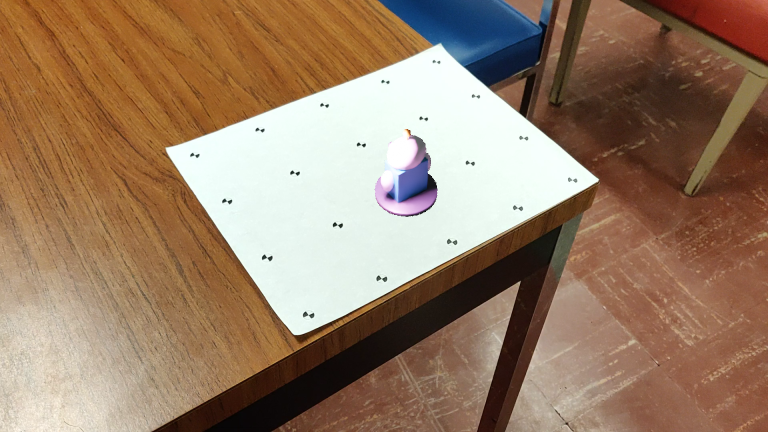
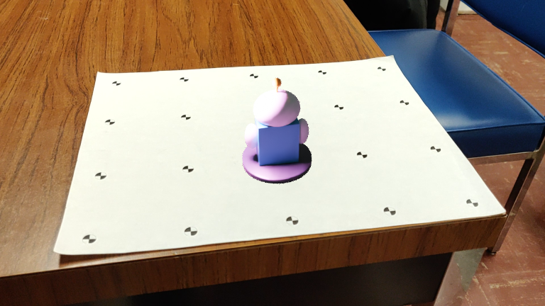

# Лабораторная работа № 1

Баранов Вадим Сергеевич · ПИН-21м · МИЭТ

## Отчёт

## Введение

Цель работы — добавить трёхмерный объект в видеосцену, снятую движущейся камерой, и синхронизировать виртуальную камеру с движением съёмочной камеры. Для работы использован видеоклип с плоской разметкой на столе и сохранённый учебный проект Blender с рассчитанной камерой [2].

## 1 Исходные данные и постановка задачи

Исходный клип имеет разрешение 1920×1080, частоту 29,87 кадра/с и 139 кадров. На листе присутствуют контрастные метки, пригодные для автоматического отслеживания. В сцену добавлен стилизованный робот: корпус, голова, глаза, антенна и боковые манипуляторы.

Основные параметры видеоклипа и реконструкции представлены в таблице 1.

Т а б л и ц а 1 - Параметры клипа и камеры

| Параметр | Значение |
| --- | --- |
| Длина клипа | 139 кадров |
| Частота кадров | 29,87 кадра/с |
| Разрешение | 1920×1080 |
| Фокусное расстояние камеры | 33,70 мм |
| Число треков | 12 |
| Средняя ошибка реконструкции | 0,3768 |

## 2 Настройка трекинга камеры

Сведения о трекинге камеры приведены в руководстве Blender [1]. В Movie Clip Editor подключён исходный клип к учебному проекту [2], содержащему треки характерных элементов листа. Использована реконструкция камеры из учебного проекта [2] с ключевыми кадрами 41 и 124. Средняя ошибка решения составила 0,3768, что позволяет использовать полученную виртуальную камеру для совмещения объекта с плоскостью стола. Решение содержит 140 кадров реконструкции; для композитинга использованы 139 кадров исходного видео.

## 3 Создание и композитинг 3D-объекта

Робот смоделирован примитивами Blender и размещён на поверхности листа. Для материала корпуса использован синий цвет, для головы — светлый, для антенны — оранжевый. Рендер выполнялся с прозрачным фоном, после чего альфа-слой совмещался с исходным видео. Итоговая последовательность содержит 139 кадров. Начальный и последующий кадры результата показаны на рисунках 1 и 2.

*Рисунок 1 - Совмещение в начале клипа*

Результат после движения камеры показан на рисунке 2.

*Рисунок 2 - Совмещение после движения камеры*

## Заключение

Использованы готовые результаты отслеживания движения камеры и реконструкция виртуальной камеры Blender из учебного проекта [2]. В сцену добавлен авторский 3D-объект, а результат совмещён с исходным видеорядом. Сохранены проект Blender, исходный клип, итоговый MP4 и контрольные кадры.

## Список литературных источников

1. Blender Manual. Motion Tracking. URL: https://docs.blender.org/manual/en/4.1/movie_clip/tracking/introduction.html (дата обращения: 17.11.2026).

2. Coeleveld T. Blender camera tracking. URL: https://coeleveld.com/blender-camera-tracking-video/ (дата обращения: 17.11.2026).

## Файлы и запуск

- [Итоговый видеоролик](result.mp4), [исходный клип](video_source.mp4).
- [Проект Blender](project.blend) — исходный клип должен находиться рядом с проектом.
- Контрольные кадры находятся в корне репозитория.

Реконструкция движения камеры и треки взяты из учебного проекта, указанного в списке источников. Для итогового видео отрендерен слой модели с прозрачностью и совмещён с исходным клипом.
